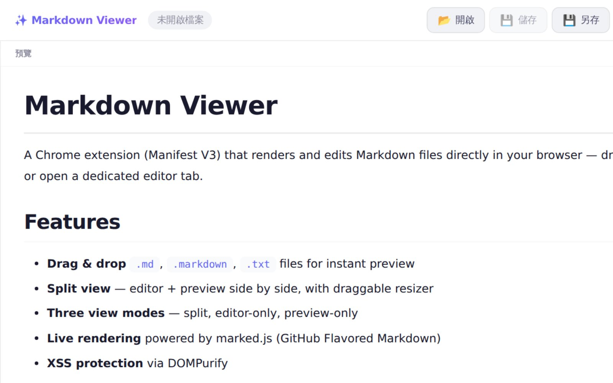

# Markdown Viewer

[English](README.en.md)

Chrome 擴充功能（Manifest V3），直接在瀏覽器裡預覽和編輯 Markdown。把本機的 `.md` 檔拖進 Chrome 就能立刻看到排版結果，也可以開啟獨立的編輯分頁。



## 功能

- **拖放開檔**：把 `.md`、`.markdown`、`.txt` 檔拖進 Chrome 即可預覽
- **分割檢視**：編輯器與預覽並排，中間的分隔線可以拖曳調整
- **三種檢視模式**：分割、只看編輯器、只看預覽
- **即時渲染**：使用 marked.js（支援 GitHub Flavored Markdown）
- **XSS 防護**：使用 DOMPurify 過濾內容
- **Mermaid 圖表**
- **深色／淺色主題**，會記住你的選擇
- **草稿自動儲存**（存在 Chrome 儲存空間）
- **儲存／另存新檔**：可覆寫原檔，或下載成新的 `.md`
- **全螢幕模式**
- **用檔案選擇器開啟本機檔案**
- **載入圖片**（需要授予資料夾存取權限）

## 安裝

### 手動安裝（開發人員模式）

1. 下載這個 repo：
   ```bash
   git clone https://github.com/cornming/Markdown-Viewer.git
   ```
2. 在 Chrome 開啟 `chrome://extensions/`
3. 開啟右上角的**開發人員模式**
4. 按**載入未封裝項目**，選擇剛才下載的專案資料夾

### 重要：開啟檔案存取權限

要使用拖放本機檔案（`file://` 網址）的功能，需要：

1. 到 `chrome://extensions/`
2. 找到 **Markdown Viewer**，按**詳細資料**
3. 開啟**允許存取檔案網址**

## 使用方式

### 方式一：拖放檔案

把本機的 `.md` 檔拖進 Chrome。擴充功能會攔截 `file://*.md` 網址，並用完整的編輯介面顯示內容。

### 方式二：點擴充功能圖示

點瀏覽器工具列上的 Markdown Viewer 圖示，會開啟獨立的編輯／預覽分頁。

## 快速鍵

| 快速鍵 | 功能 |
|--------|------|
| `Ctrl + O` | 開啟檔案 |
| `Ctrl + S` | 儲存（覆寫） |
| `Ctrl + Shift + S` | 另存新檔 |
| `F` | 切換全螢幕 |
| `Ctrl + +` / `Ctrl + -` / `Ctrl + 0` | 滑鼠停在 Mermaid 圖表上時，縮放圖表／還原 100% |

## 使用的技術

- Chrome 擴充功能 Manifest V3
- [marked.js](https://github.com/markedjs/marked)：Markdown 解析（GFM）
- [DOMPurify](https://github.com/cure53/DOMPurify)：XSS 過濾
- [mermaid.js](https://github.com/mermaid-js/mermaid)：圖表渲染
- 原生 JavaScript／CSS，沒有使用框架

## 授權

目前尚未指定授權。
